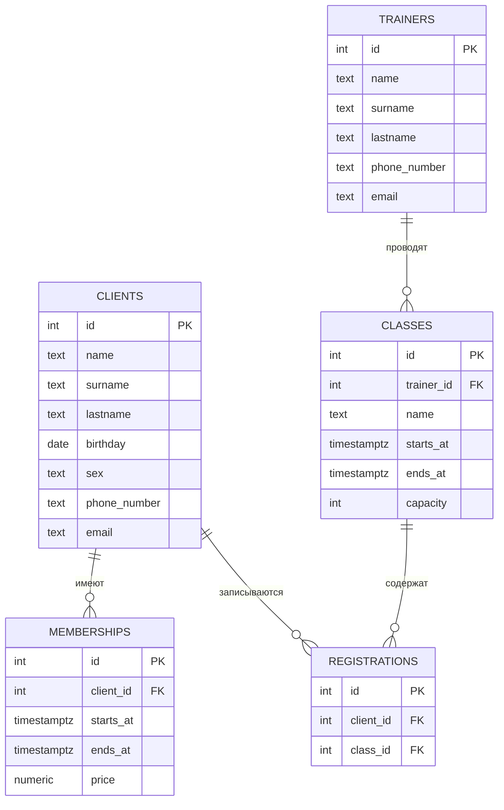

## Название проекта

Тема № 4: Фитнес-клуб. База хранит данные о клиентах, тренерах, абонементах, занятиях и записях клиентов на занятия, эти данные нужны сотрудникам фитнес-клуба для работы с клиентами и управления расписанием.

| | |
| --- | --- |
| Главная таблица | `clients` - клиенты фитнес-клуба |
| Связь N:M | Занятие и клиент через `registations` |
| Бизнес-правило | На занятие не больше N человек|
| СУБД | PostgreSQL 17 в Docker |

## Задания курса

Правила курса, установка и порядок сдачи: [docs/README.md](docs/README.md).

| Лаба | Задание |
| --- | --- |
| 1. Модель данных и схема | [docs/lab-1.md](docs/lab-1.md) |
| 2. Запросы | [docs/lab-2.md](docs/lab-2.md) |
| 3. Логика в базе | [docs/lab-3.md](docs/lab-3.md) |
| 4. Транзакции и доступ | [docs/lab-4.md](docs/lab-4.md) |
| 5. Производительность | [docs/lab-5.md](docs/lab-5.md) |
| Витрина к защите | [docs/showcase.md](docs/showcase.md) |

## Как запустить

```bash
cp .env.example .env          # пароли и порт
docker compose up -d          # при первом запуске выполняются скрипты из db/
dbcheck run demo/lab1.sql     # сценарий лабы 1
```

Работа с базой: `docker compose exec db psql -U postgres -d app`. Сценарии выполняются в `psql` командой `\i /demo/lab1.sql`.

После изменения скриптов в `db/` базу нужно пересоздать: `docker compose down -v && docker compose up -d`.

## ER-диаграмма



## Ограничения

| Ограничение | Таблица и колонки | Зачем |
| --- | --- | --- |
| `UNIQUE` | `clients.email` | Нельзя добавить двух клиентов с одинаковым email |
| `UNIQUE` | `trainers.email` | Нельзя добавить двух тренеров с одинаковым email |
| `UNIQUE` | `registrations (client_id, class_id)` | Не дает одному клиенту записаться на одно занятие несколько раз |
| `CHECK` | `clients.sex` | Разрешает только значения `мужской` или `женский`, чтобы нельзя было написать любое слово |
| `CHECK` | `clients.phone_number` | Проверяет, что номер телефона начинается с `+7` и содержит 10 цифр после |
| `CHECK` | `trainers.phone_number` | Проверяет, что номер телефона начинается с `+7` и содержит 10 цифр после |
| `CHECK` | `memberships.ends_at` и `memberships.starts_at` | Дата окончания абонемента должна быть позже даты начала |
| `CHECK` | `memberships.price` | Стоимость абонемента должна быть больше 0 |
| `CHECK` | `classes.ends_at` и `classes.starts_at` | Время окончания занятия должно быть позже времени начала |
| `CHECK` | `classes.capacity` | Вместимость должна быть больше 0, чтобы на занятие могли записаться |

## Что сделано по лабам

| Лаба | Что сделано | Сценарий |
| --- | --- | --- |
| 1 | ... | `demo/lab1.sql` |
| 2 | ... | `demo/lab2.sql` |
| 3 | ... | `demo/lab3.sql` |
| 4 | ... | `demo/lab4.sql`, `demo/race.sql`, `demo/race_fixed.sql` |
| 5 | ... | `demo/lab5.sql` |


## Нормализация

Если хранить все данные фитнес-клуба в одной таблице, то информация о клиенте, его абонементе, тренере и занятии была бы в одной строке, а при записи одного клиента на несколько занятий его личные данные пришлось бы повторять по нескольку раз:

| client_id | client_name | client_phone | membership_start | membership_end | trainer_name | class_name | class_start |
| --- | --- | --- | --- | --- | --- | --- | --- |
| 1 | Иван Иванов | +79991234567 | 01.10.2026 | 31.10.2026 | Петров Пётр Петрович | Йога | 02.10.2026 18:00 |
| 1 | Иван Иванов | +79991234567 | 01.10.2026 | 31.10.2026 | Петров Пётр Петрович | Йога | 04.10.2026 18:00 |

Чтобы убрать повторение данных, исходная таблица делится на отдельные сущности:

`clients` - данные клиентов

`memberships` - абонементы клиентов

`trainers` - данные тренеров

`classes` - занятия

`registrations` - записи клиентов на занятия

Данные клиента хранятся одной записью в `clients`, а другие таблицы используют `client_id`. Данные тренера хранятся один раз в `trainers`, а таблица `classes` использует id.
`registrations` связывает клиентов и занятия, поэтому один клиент может быть записан на несколько занятий и на одно занятие может быть записано несколько клиентов, без дублирования информации о них.
Такое разделение устраняет повторение данных.

## Типы данных

| Тип | Где используется | Почему |
| --- | --- | --- |
| `numeric(10,2)` | `memberships.price` | используется для точного хранения денежных значений |
| `timestamptz` | `memberships.starts_at`, `memberships.ends_at`, `classes.starts_at`, `classes.ends_at` | хранит дату и время с часовым поясом |
| `date` | `clients.birthday` | зранит только дату, для дня рождения время не нужно |
| `integer` | id, `classes.capacity` | для целых числовых значений |
| `text` | ФИО, телефон, email, название занятия | для строковых данных |
| `CHECK` | `clients.sex`, `clients.phone_number`, `trainers.phone_number`, `memberships.ends_at`, `memberships.price`, `classes.capacity`| проверяет правильность вводимых данных, чтобы не были записаны недопустимые значения |


## ON DELETE

| Связь | Поведение | Причина |
| --- | --- | --- |
| `memberships.client_id → clients.id` | `CASCADE` | при удалении клиента его абонементы больше не нужны |
| `classes.trainer_id → trainers.id` | `RESTRICT` | нельзя удалить тренера, пока есть занятия, которые он ведёт |
| `registrations.client_id → clients.id` | `CASCADE` | при удалении клиента его записи на занятия удаляются |
| `registrations.class_id → classes.id` | `CASCADE` | при удалении занятия записи на него удаляются |

<!--
Разделы, которые добавляются по ходу курса:
  лаба 4: «Гонка»;
  лаба 5: «Производительность» (таблица до / после, когда индекс не помогает, размеры).
-->
